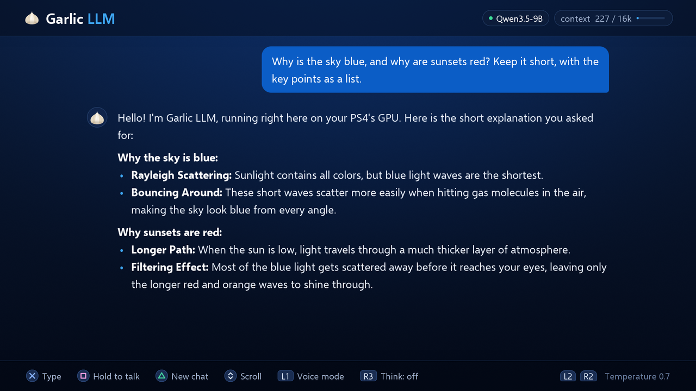

<p align="center"></p>

# Garlic LLM

**A 9-billion-parameter language model running on a PS4. Offline.**

Garlic LLM is a homebrew app for the PlayStation 4. It runs [Qwen3.5-9B](https://huggingface.co/Qwen) on the console's own GPU, with no PC and no internet while it runs. It also listens, talks, and runs the Python it writes.

[Website](https://garlicllm.dev) · [Download](#install) · [Demo video](https://garlicllm.dev/#demo) · [Support the project](#support)



## What it does

| Feature | Details |
|---|---|
| **Text chat** | Qwen3.5-9B at 31–39 tokens/s, and up to 43 tokens/s on code. 16K-token context. |
| **Voice conversation** | Speak and it answers aloud (Chatterbox) in Spanish, English, Portuguese, Russian, Italian, French and German. |
| **Dictation** | Hold a button and talk instead of typing (Parakeet TDT 0.6B v3), in 25 European languages. |
| **Python mode** | Ask for a program. It writes MicroPython and the console runs it. |
| **Think mode** | The model reasons before it answers. Off by default; a thought takes about half a minute. |

Everything runs on the console. Nothing is sent anywhere.

Speeds were measured on a base/Slim PS4. In voice mode the chat model runs at about 22 tokens/s, because the voice model takes the memory that speculative decoding uses.

## Requirements

- A PS4 running [GoldHEN](https://github.com/GoldHEN/GoldHEN). Tested on a base/Slim console with firmware 11.52.
- About 6 GB of free space, or 12 GB if you copy the package to the console's own disk before installing it.
- To use your voice: any ordinary microphone the console recognises.

The PS4 Pro and other firmware versions are not tested yet. If you try one, please [open an issue](https://github.com/leonardo-alegria/garlic-llm/issues) with the result.

## Install

1. Download the all-in-one package (about 5.7 GB, models inside) from [Hugging Face](https://huggingface.co/garlic-llm/garlic-llm-ps4).
2. Copy the PKG to the console and install it like any other homebrew package (*Settings → Debug Settings → Game → Package Installer*).
3. Open **Garlic LLM** from the home screen. The first screen loads the model; after that it needs no PC and no connection.

**Updating.** Download the new package and install it over the old one. The models are inside, so there is nothing else to copy.

## Controls

**Chat**

| Button | Action |
|---|---|
| ✕ | Type a message |
| □ (hold) | Dictate a message; release to finish |
| ○ | Stop the answer |
| △ | New chat |
| ↑ ↓ or left stick | Scroll |
| L1 | Voice mode |
| R1 | Run the Python program in the last answer |
| R3 or touchpad | Think mode on / off |
| L2 / R2 | Temperature down / up |

After dictating, choose what to do with the text: ✕ send, △ edit, □ record again, ○ discard.

**Keyboard**

| Button | Action |
|---|---|
| ✕ | Type the selected key |
| □ | Delete (hold to repeat) |
| △ | Space |
| L1 | Shift |
| R1 | Emoji |
| L2 (hold) | Dictate and add the text |
| R2 | Send |
| ○ | Close |

**Voice mode:** hold □ to talk (this also interrupts the answer), △ starts a new chat, ○ leaves voice mode.

The interface follows the console's language: English, Spanish, Portuguese or Russian.

## How it works

A PS4 gives homebrew no compute API and no machine-learning library, so Garlic LLM talks to the GPU directly.

- **Compute kernels.** The model's operations (matrix products over 4-bit weights, attention, normalisation) are OpenCL C kernels compiled by LLVM for the console's GCN architecture. They are in [`shaders/`](shaders/).
- **Hand-written command buffers.** The app dispatches those kernels by writing PM4 packets itself, the low-level commands a graphics driver would normally generate.
- **Speculative decoding.** Qwen3.5's own MTP head drafts up to two tokens ahead, and the full model verifies them in one pass.
- **Custom Q4 and Q3 weights.** The 9B is stored in two formats made for these kernels. Q4 holds 4-bit weights and is used for most matrices and the output head. Q3 holds 3-bit weights (about 3.5 bits each with their scales) and is used for the two largest matrices of each layer, the MLP's gate and up projections. Storing everything in Q4 would take about 384 MiB more, which the console does not have free.
- **4-bit attention cache.** The attention cache is quantized to 4 bits too, which is how a 16K context fits.
- **GPU-visible memory.** The weights live in "Garlic" memory, the PS4's name for the memory the GPU reads directly. That is where the project's name comes from.
- **The rest is plain C.** The tokenizer, the user interface, the text renderer and the audio path run on the CPU. Python programs run on an embedded [MicroPython](https://micropython.org).

The app is built with the open-source [OpenOrbis](https://github.com/OpenOrbis/OpenOrbis-PS4-Toolchain) toolchain. The techniques, the measurements and the dead ends are written up in a 147-page guide, [*Nine Billion Parameters on a PS4*](https://ko-fi.com/s/5d8050b149).

## Build from source

You only need this to change the app. The build scripts are written for Windows.

**Tools**

- Python 3 with `numpy` and `Pillow`.
- The [OpenOrbis PS4 Toolchain](https://github.com/OpenOrbis/OpenOrbis-PS4-Toolchain) in `toolchain/OpenOrbis/PS4Toolchain/`.
- [Zig](https://ziglang.org) in `toolchain/zig/`. Its bundled clang compiles both the C code and the GCN kernels.
- The .NET runtime in `toolchain/dotnet/`, for OpenOrbis' package tool.

To keep the tools somewhere else, set the `GARLIC_TOOLCHAIN` environment variable to that folder.

**Build the app**

```bash
python build_chat.py
```

This writes the PKG to `build/chat/`. Add `--upload` to also copy the package to the console over FTP. For `--upload`, set the `PS4_IP` environment variable to your console's address and start GoldHEN's FTP server.

The app's data files (fonts, tokenizer tables, compiled kernels) are already in `chat/assets*`, so a build does not need the scripts in `pc/`.

**Model files**

A plain build keeps the weights outside the package. The app looks for each of these files first inside its package (`/app0/models`) and then in `/data` on the console:

| File | Size | Contents |
|---|---|---|
| `qwen3.5-9b-q4s.bin` | 4.32 GiB | Qwen3.5-9B |
| `qwen3.5-9b-mtp.bin` | 0.20 GiB | The MTP head for speculative decoding |
| `parakeet-v3-q4i.bin` | 0.33 GiB | Speech to text |
| `chatterbox-t3.bin` | 0.29 GiB | Text to speech, first stage |
| `chatterbox-s3gen-mf.bin` | 0.09 GiB | Text to speech, second stage |

The code can also build a smaller app with Qwen3.5-4B (`--4b`, weights in `qwen3.5-4b-q4i.bin`). It has no speculative decoding and is not released as a package.

Download them from [Hugging Face](https://huggingface.co/garlic-llm/garlic-llm-ps4). `python pc/upload_model.py <file>` copies a file to `/data` on the console. To build the all-in-one package instead, put the files in `models/` and add `--full` to the build command.

The scripts that made them from the original checkpoints are in `pc/`, and each one's header describes its inputs and the file format it writes. The first conversion of the Qwen models (`pc/modal_qwen35*.py`) runs on [Modal](https://modal.com), on machines with 32 to 64 GB of memory.

**Repository layout**

| Path | Contents |
|---|---|
| `chat/` | The app: engine, user interface, tokenizer, voice, Python runner |
| `chat/py/` | MicroPython and its port to the console |
| `shaders/` | The GPU kernels |
| `pc/` | Converters for the models, reference implementations in NumPy, and the scripts that build the app's data files |
| `build_chat.py` | Builds the PKG |

## Troubleshooting

- **"Couldn't start".** A model file is missing or incomplete. Install the package again. With a build from source, check the files in `/data` against the table above.
- **Dictation hears nothing.** Check that the console sees your microphone, and keep □ held while you speak.
- **Anything else.** The app writes a log to `/data/ps4ai_log.txt`. Attach it when you [open an issue](https://github.com/leonardo-alegria/garlic-llm/issues).

## Questions

**Does it need internet?** No. The model, the voices and the speech recognition run on the console.

**Does it run on a PS4 Pro?** Not tested yet.

**And on a PS5?** No. Garlic LLM is written for the PS4's GPU and system software.

**Can it harm my console?** It is an ordinary homebrew app and contains no exploit. It needs GoldHEN, which you install at your own risk.

**Is this the first AI on a PS4's GPU?** As far as I know, yes. I found no earlier public project that runs a language model on the PS4's GPU. If you know of one, please [open an issue](https://github.com/leonardo-alegria/garlic-llm/issues).

## Support

Garlic LLM is free and open source. If you want to see more of it (more consoles tested, faster kernels), you can help fund the work:

- [PayPal](https://www.paypal.com/donate/?business=leonardoalegria2002%40gmail.com&currency_code=USD)
- [Ko-fi](https://ko-fi.com/leonardoalegria)
- Buy the guide, [*Nine Billion Parameters on a PS4*](https://ko-fi.com/s/5d8050b149) (PDF, pay what you want from 19 USD)

Bug reports and test results from other consoles help just as much.

## Licence and credits

The app's code is licensed under the [GNU General Public License v3.0](LICENSE). The models and third-party components keep their own licences:

| Component | Author | Licence |
|---|---|---|
| Qwen3.5-9B and Qwen3.5-4B | Alibaba Qwen | Apache-2.0 |
| Chatterbox (text to speech) | Resemble AI | MIT |
| Parakeet TDT 0.6B v3 (speech to text) | NVIDIA | CC-BY-4.0 |
| MicroPython | The MicroPython project | MIT |
| Twemoji | Twitter, Inc. and other contributors | CC-BY-4.0 |
| Fonts: Selawik, Noto, Arimo, Inconsolata, Cascadia Mono | Their authors | SIL OFL 1.1 |
| DejaVu Sans | Its authors | Bitstream Vera licence and public domain |

The complete notices are in [`CREDITS.md`](CREDITS.md) and ship inside the app.

Garlic LLM is built with the [OpenOrbis PS4 Toolchain](https://github.com/OpenOrbis/OpenOrbis-PS4-Toolchain) and runs on consoles with [GoldHEN](https://github.com/GoldHEN/GoldHEN). Both are third-party projects by their own authors, and Garlic LLM would not exist without them.

## Contact

Garlic LLM is built by [Leonardo Alegría](https://www.linkedin.com/in/leonardoalegria/). Questions, collaborations and press: [leo@garlicllm.dev](mailto:leo@garlicllm.dev). Bugs and test results go to [GitHub issues](https://github.com/leonardo-alegria/garlic-llm/issues).

---

Not affiliated with or endorsed by Sony Interactive Entertainment. PlayStation and PS4 are trademarks of their owners.
